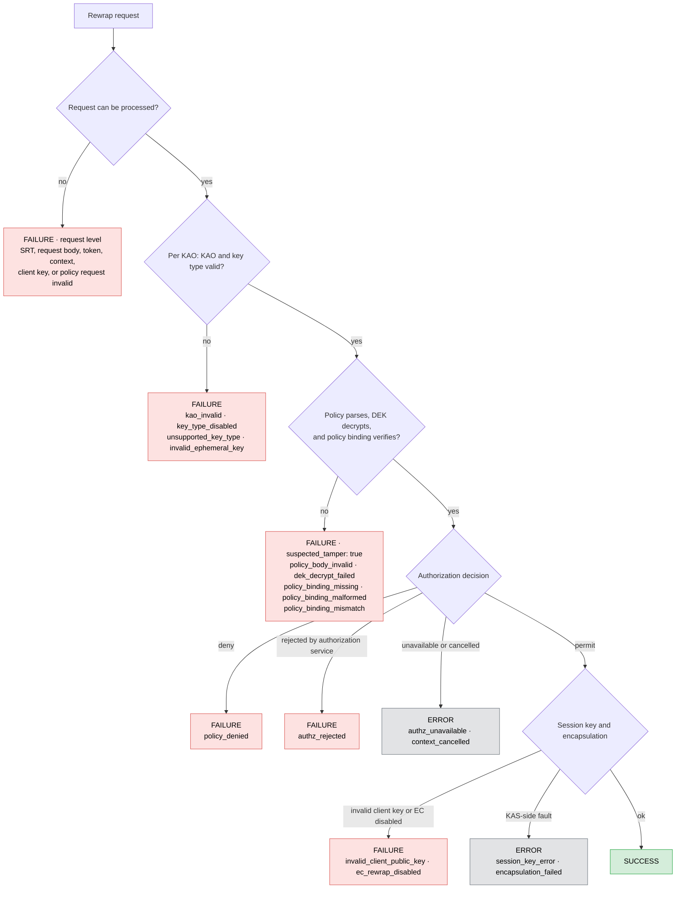

# Rewrap audit outcomes

KAS records one `rewrap` audit event for each key access object (KAO) it
processes. A failure that prevents KAO processing or cannot be attributed to a
KAO produces a request-level event instead. All rewrap events use
`action.type: rewrap` and `object.type: key_object`.

- `success`: KAS returned the rewrapped key.
- `failure`: KAS deliberately rejected the request, including authorization
  denials, validation failures, and suspected tamper.
- `error`: KAS or a dependency could not complete the operation.

The diagram summarizes the main processing flow. The table below is the
complete outcome reference.

| Stage | Case | `action.result` | `failure_reason` | `suspected_tamper` | `policy_verified` | Scope |
|---|---|---|---|---|---|---|
| Request | SRT cannot be parsed or its claims are invalid | `failure` | `srt_invalid` | `false` | `false` | request |
| Request | SRT signature verification fails | `failure` | `srt_signature_invalid` | `true` | `false` | request |
| Request | Request body inside the SRT is invalid | `failure` | `request_body_invalid` | `false` | `false` | request |
| Request | Client public key is missing, unparseable, or unsupported | `failure` | `invalid_client_public_key` | `false` | `false` | request |
| Request | Access token or entity information is missing | `failure` | `missing_access_token` | `false` | `false` | request |
| Request | `X-Rewrap-Additional-Context` is invalid | `failure` | `invalid_rewrap_context` | `false` | `false` | request |
| Policy request | Request or policy is nil, or the policy ID is empty | `failure` | `invalid_request` | `false` | `false` | request |
| Policy request | No KAOs and the policy body is valid | `failure` | `kao_invalid` | `false` | `false` | request |
| Policy request | No KAOs and the policy body is invalid | `failure` | `policy_body_invalid` | `true` | `false` | request |
| KAO validation | KAO is nil or its wrapped key is empty | `failure` | `kao_invalid` | `false` | `false` | KAO |
| KAO validation | EC, hybrid, or ML-KEM key type is disabled | `failure` | `key_type_disabled` | `false` | `false` | KAO |
| KAO validation | Key type is unsupported | `failure` | `unsupported_key_type` | `false` | `false` | KAO |
| KAO validation | EC ephemeral key has invalid PEM, size, type, or compression | `failure` | `invalid_ephemeral_key` | `false` | `false` | KAO |
| Integrity | Policy body cannot be decoded or parsed | `failure` | `policy_body_invalid` | `true` | `false` | KAO |
| Integrity | DEK decryption fails for RSA, EC, hybrid, or ML-KEM | `failure` | `dek_decrypt_failed` | `true` | `false` | KAO |
| Integrity | No legacy RSA key IDs are available | `failure` | `dek_decrypt_failed` | `true` | `false` | KAO |
| Integrity | Policy binding is missing | `failure` | `policy_binding_missing` | `true` | `false` | KAO |
| Integrity | Policy binding is malformed | `failure` | `policy_binding_malformed` | `true` | `false` | KAO |
| Integrity | Policy binding does not match | `failure` | `policy_binding_mismatch` | `true` | `false` | KAO |
| Authorization | Decision is deny | `failure` | `policy_denied` | `false` | `true` | KAO |
| Authorization | Authorization service rejects the call with a non-internal error | `failure` | `authz_rejected` | `false` | `true` | KAO |
| Authorization | Authorization service returns an internal error | `error` | `authz_unavailable` | `false` | `true` | KAO |
| Authorization | Request context is cancelled | `error` | `context_cancelled` | `false` | `true` | KAO |
| Rewrap | Encryptor cannot be built from the client public key | `failure` | `invalid_client_public_key` | `false` | `true` | KAO |
| Rewrap | EC client key is used while EC rewrap is disabled | `failure` | `ec_rewrap_disabled` | `false` | `true` | KAO |
| Rewrap | Ephemeral session key cannot be serialized | `error` | `session_key_error` | `false` | `true` | KAO |
| Rewrap | Encapsulating the DEK for the client fails | `error` | `encapsulation_failed` | `false` | `true` | KAO |
| Complete | Rewrapped key is returned | `success` | — | `false` | `true` | KAO |
| Fallback | A KAO reaches emission without a classification | `error` | `rewrap_incomplete` | `false` | preserved | KAO |
| Defensive fallback | A legacy v1 result cardinality invariant fails | `failure` | `invalid_request` | `false` | `false` | request |
| Defensive fallback | TDF3 rewrap unexpectedly returns an error | `error` | `rewrap_incomplete` | `false` | `false` | request |

The defensive fallback events guard invariants after normal KAO processing and
may therefore accompany KAO-level events. They are not replacements for the
normal per-KAO emission path.

## Metadata and downstream handling

Every non-success event includes `eventMetaData.failure_reason`. Every rewrap
event includes the boolean fields `policy_verified` and `suspected_tamper`.
KAO-level events also include `kao_id`; request-level events omit it.

The object ID is the parsed policy UUID when available and otherwise the policy
ID supplied by the client. A request-level event may have no object ID when the
failure occurs before a policy can be identified. Policy attributes are included
in `object.attributes` only after the policy body and binding have been verified.

When authorization, session-key creation, or another whole stage fails, the
response error applies to every KAO. It does not replace a more specific audit
outcome already assigned to a KAO. For example, a KAO that failed policy-binding
verification keeps `policy_binding_mismatch` even if a later stage also fails.

Downstream mappings must treat authorization denials as `failure`, not the
legacy `error` value. Consumers can route potential integrity incidents using
`suspected_tamper: true`.
