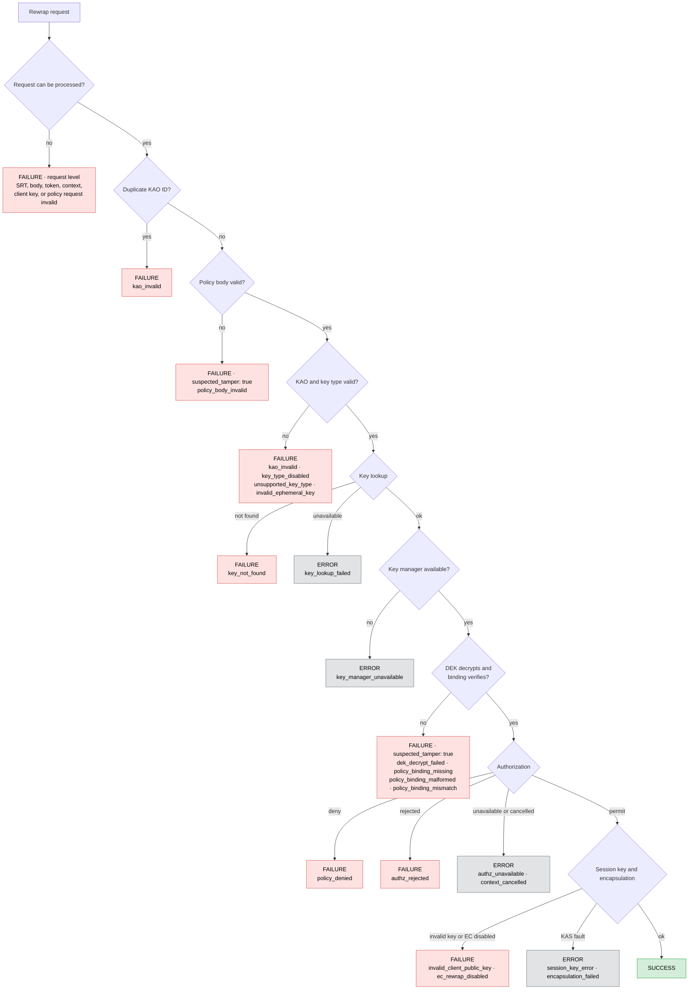

# Rewrap audit outcomes

- KAS emits one event per processed key access object (KAO).
- Failures before KAO processing emit one request-level event.
- All events use `action.type: rewrap` and `object.type: key_object`.
- Results are `success` (key returned), `failure` (request rejected), or `error`
  (KAS or a dependency could not finish).

## Outcome matrix

| Stage | Case | Result | `failure_reason` | Tamper | Verified | Scope |
|---|---|---|---|---|---|---|
| Request | SRT parse or claims invalid | failure | `srt_invalid` | false | false | request |
| Request | SRT signature invalid | failure | `srt_signature_invalid` | true | false | request |
| Request | SRT request body invalid | failure | `request_body_invalid` | false | false | request |
| Request | Client key missing, invalid, or unsupported | failure | `invalid_client_public_key` | false | false | request |
| Request | Access token or entity missing | failure | `missing_access_token` | false | false | request |
| Request | Additional context invalid | failure | `invalid_rewrap_context` | false | false | request |
| Policy request | Request or policy nil; policy ID empty | failure | `invalid_request` | false | false | request |
| Policy request | No KAOs; policy valid | failure | `kao_invalid` | false | false | request |
| Policy request | No KAOs; policy invalid | failure | `policy_body_invalid` | true | false | request |
| KAO validation | Duplicate KAO ID | failure | `kao_invalid` | false | false | KAO |
| Integrity | Policy body invalid | failure | `policy_body_invalid` | true | false | KAO |
| KAO validation | KAO nil, wrapped key empty, or required key ID missing | failure | `kao_invalid` | false | false | KAO |
| KAO validation | EC, hybrid, or ML-KEM disabled | failure | `key_type_disabled` | false | false | KAO |
| KAO validation | Key type unsupported | failure | `unsupported_key_type` | false | false | KAO |
| KAO validation | EC ephemeral key invalid | failure | `invalid_ephemeral_key` | false | false | KAO |
| Key lookup | Key ID not found or no legacy RSA key IDs | failure | `key_not_found` | false | false | KAO |
| Key lookup | Registry unavailable | error | `key_lookup_failed` | false | false | KAO |
| Key management | Manager unavailable | error | `key_manager_unavailable` | false | false | KAO |
| Integrity | DEK decryption failed | failure | `dek_decrypt_failed` | true | false | KAO |
| Integrity | Policy binding missing | failure | `policy_binding_missing` | true | false | KAO |
| Integrity | Policy binding malformed | failure | `policy_binding_malformed` | true | false | KAO |
| Integrity | Policy binding mismatch | failure | `policy_binding_mismatch` | true | false | KAO |
| Authorization | Decision denied | failure | `policy_denied` | false | true | KAO |
| Authorization | Service rejected request | failure | `authz_rejected` | false | true | KAO |
| Authorization | Service unavailable | error | `authz_unavailable` | false | true | KAO |
| Authorization | Context cancelled | error | `context_cancelled` | false | true | KAO |
| Rewrap | Client encryptor creation failed | failure | `invalid_client_public_key` | false | true | KAO |
| Rewrap | EC rewrap disabled | failure | `ec_rewrap_disabled` | false | true | KAO |
| Rewrap | Session key serialization failed | error | `session_key_error` | false | true | KAO |
| Rewrap | DEK encapsulation failed | error | `encapsulation_failed` | false | true | KAO |
| Complete | Rewrapped key returned | success | — | false | true | KAO |
| Fallback | KAO unclassified | error | `rewrap_incomplete` | false | preserved | KAO |
| Defensive | Legacy v1 result count invalid | failure | `invalid_request` | false | false | request |

Defensive request events may accompany KAO events.

## Metadata

- Non-success events include `failure_reason`.
- All events include `policy_verified` and `suspected_tamper`; only KAO events
  include `kao_id`.
- `object.id` is the verified policy UUID, then the request policy ID, or empty.
- Unverified parsed UUIDs are recorded as `claimed_policy_uuid` metadata.
- `object.attributes` is populated only after policy verification.
- Stage-wide failures preserve earlier, more specific KAO audit outcomes.
- Downstream mappings must treat denials as `failure`; use
  `suspected_tamper: true` for integrity alerts.
